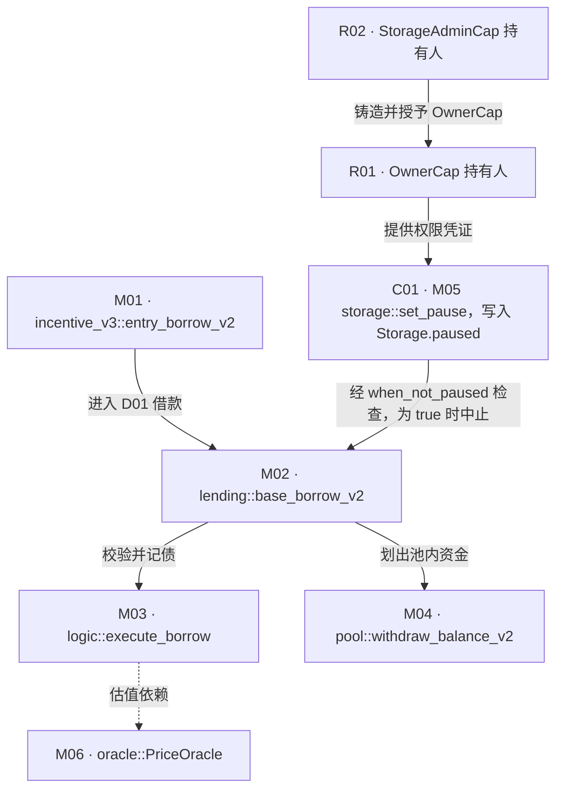

# NAVI 前期准备最小样例（v0.2，已归档）

> 这是旧版「一张图 + 一张表」交付形式的样例，只用于参考历史。现行交付物见[工作流](../../工作流/README.md)的 P1–P6 和[交付物字段表](../../工作流/交付物字段表.md)。

以下用固定 commit 的公开源码演示借款 v2 和暂停控制。`B01` 是样例的候选源码记录，生产部署及源码对应关系在本例中均待核验。图、表中的职责、角色和档位只描述该份样例源码。正式图表按上述链上基线与全量范围要求交付。

| ID | 记录类型 | 对象及归属 | 事实与边界 | 关联 ID | 证据定位 | 状态 | 档位及理由 |
| --- | --- | --- | --- | --- | --- | --- | --- |
| B01 | 代码基线（样例） | NAVI Lending | 候选源码为 `naviprotocol/navi-smart-contracts` 的 `9ff791fe309358a8bf6f3783a2aeb0c95f72a1dd`。样例范围为 `lending_core` 中的借款 v2 与暂停路径，依赖 `oracle::PriceOracle`。 | M01–M06 | [候选源码版本](https://github.com/naviprotocol/navi-smart-contracts/tree/9ff791fe309358a8bf6f3783a2aeb0c95f72a1dd) | 样例源码已固定，生产部署标识和源码匹配证据待核实 | — |
| M01 | 模块 | `lending_core::incentive_v3` | `entry_borrow_v2` 调用 `lending::borrow_coin_v2`，将返回的资金交给调用者。 | M02、D01 | [借款入口](https://github.com/naviprotocol/navi-smart-contracts/blob/9ff791fe309358a8bf6f3783a2aeb0c95f72a1dd/lending_core/sources/incentive_v3.move#L1119) | 源码确认 | — |
| M02 | 模块 | `lending_core::lending` | `borrow_coin_v2` 进入 `base_borrow_v2`，先检查暂停状态，再调用记债和出池逻辑。 | M03、M04、M05、D01、C01 | [调用入口](https://github.com/naviprotocol/navi-smart-contracts/blob/9ff791fe309358a8bf6f3783a2aeb0c95f72a1dd/lending_core/sources/lending.move#L312) · [借款执行](https://github.com/naviprotocol/navi-smart-contracts/blob/9ff791fe309358a8bf6f3783a2aeb0c95f72a1dd/lending_core/sources/lending.move#L352) | 源码确认 | — |
| M03 | 模块 | `lending_core::logic` | `execute_borrow` 校验借款、更新债务并检查健康因子，偿付能力估值依赖价格数据。 | M06、D01 | [借款逻辑](https://github.com/naviprotocol/navi-smart-contracts/blob/9ff791fe309358a8bf6f3783a2aeb0c95f72a1dd/lending_core/sources/logic.move#L129) · [负债估值](https://github.com/naviprotocol/navi-smart-contracts/blob/9ff791fe309358a8bf6f3783a2aeb0c95f72a1dd/lending_core/sources/logic.move#L518) | 源码确认 | — |
| M04 | 模块 | `lending_core::pool` | `withdraw_balance_v2` 从池中划出资金并返回余额。 | D01 | [出池实现](https://github.com/naviprotocol/navi-smart-contracts/blob/9ff791fe309358a8bf6f3783a2aeb0c95f72a1dd/lending_core/sources/pool.move#L216) | 源码确认 | — |
| M05 | 模块 | `lending_core::storage` | 保存 `Storage.paused`，提供暂停入口和检查函数。 | R01、R02、C01 | [暂停检查](https://github.com/naviprotocol/navi-smart-contracts/blob/9ff791fe309358a8bf6f3783a2aeb0c95f72a1dd/lending_core/sources/storage.move#L220) · [暂停入口](https://github.com/naviprotocol/navi-smart-contracts/blob/9ff791fe309358a8bf6f3783a2aeb0c95f72a1dd/lending_core/sources/storage.move#L323) | 源码确认 | — |
| M06 | 依赖边界 | `oracle::PriceOracle` | 借款的抵押和债务估值使用的价格依赖。 | M03 | [抵押物估值](https://github.com/naviprotocol/navi-smart-contracts/blob/9ff791fe309358a8bf6f3783a2aeb0c95f72a1dd/lending_core/sources/logic.move#L529) | 源码确认依赖 | — |
| D01 | 代码职责 | 核心借贷／借款发放与债务记账 | 新增借款债务并从对应池划款。 | M01–M04、C01 | [记债与出池调用](https://github.com/naviprotocol/navi-smart-contracts/blob/9ff791fe309358a8bf6f3783a2aeb0c95f72a1dd/lending_core/sources/lending.move#L369) | 样例源码确认 | **5（示例）**，直接改变用户债务和池内资产。 |
| R01 | 特权角色 | `storage::OwnerCap` 持有人 | 初始化时授予发布者，R02 也可以授予新的 `OwnerCap`。可调用 C01。 | M05、R02、C01 | [初始化授权](https://github.com/naviprotocol/navi-smart-contracts/blob/9ff791fe309358a8bf6f3783a2aeb0c95f72a1dd/lending_core/sources/storage.move#L198) · [后续授予](https://github.com/naviprotocol/navi-smart-contracts/blob/9ff791fe309358a8bf6f3783a2aeb0c95f72a1dd/lending_core/sources/storage.move#L822) | 源码确认能力，当前持有人待核实 | — |
| R02 | 特权角色 | `storage::StorageAdminCap` 持有人 | 初始化时授予发布者，可调用 `mint_owner_cap` 向指定接收方铸造并授予 R01 的凭证。 | M05、R01、C01（间接） | [初始化授权](https://github.com/naviprotocol/navi-smart-contracts/blob/9ff791fe309358a8bf6f3783a2aeb0c95f72a1dd/lending_core/sources/storage.move#L198) · [授予入口](https://github.com/naviprotocol/navi-smart-contracts/blob/9ff791fe309358a8bf6f3783a2aeb0c95f72a1dd/lending_core/sources/storage.move#L822) | 源码确认能力，当前持有人待核实 | — |
| C01 | 关键控制 | 暂停门控在借款路径上的作用 | `set_pause` 要求 `OwnerCap` 并校验目标 `Storage` 版本。写入 `Storage.paused` 后，`base_borrow_v2` 经 `when_not_paused` 检查，为 `true` 时在记债和出池前中止。设为 `false` 解除这道暂停检查。 | M05、R01、D01 | [控制写入](https://github.com/naviprotocol/navi-smart-contracts/blob/9ff791fe309358a8bf6f3783a2aeb0c95f72a1dd/lending_core/sources/storage.move#L323) · [借款检查点](https://github.com/naviprotocol/navi-smart-contracts/blob/9ff791fe309358a8bf6f3783a2aeb0c95f72a1dd/lending_core/sources/lending.move#L363) | 源码确认条件，当前状态待核实 | — |
