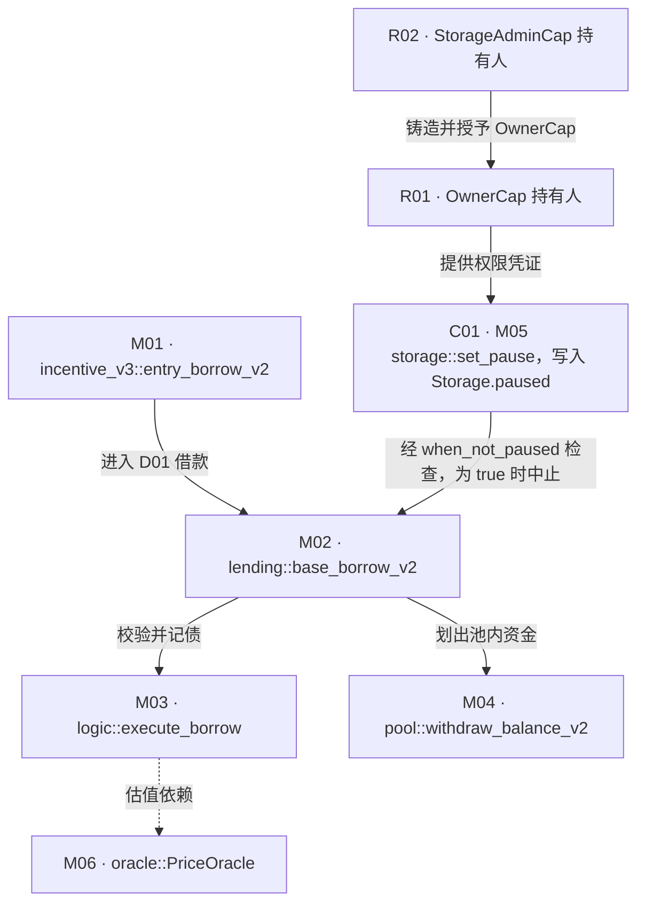

# BitsScore 合约评估前期准备

- 文档版本 v0.2
- 更新日期 2026-11-24

## 一、要做什么

**以目标生产网络上实际执行的合约代码为基准。** 先锁定评估时点的部署和执行版本，获取并核验对应源码，再用这份源码梳理项目的业务类型、组件和模块、关键资产与状态变化，以及特权角色能通过哪些代码改变这些结果。按业务功能组织范围，按实际代码职责定 5／3／1 档位。

准备结果作为后续审计报告核对和链上核验的共同基线。正式交付覆盖评估范围内的**全部组件、模块和特权角色**，包括辅助和共享模块、间接授予权限的角色，并标明关键外部依赖的边界。证据不足时，列出已核实部分及未能核实的范围。

## 二、怎么做

### 1. 锁定链上部署版本并核验源码

1. **确认生产环境实际执行的代码。** 固定目标网络和评估区块或检查点。以项目部署清单及生产交易的调用目标为线索，用链上记录确认入口、实际执行的合约地址或包 ID，以及在范围内的关键依赖。保存发布或升级交易、可复查的链上查询和代码产物或摘要。同一业务有多个版本同时运行时，逐一记录其适用范围。
   - **EVM** 项目同时记录入口和实现。涉及代理时，按评估区块解析实际实现，覆盖适用的 Beacon 或多实现路由，并用浏览器或节点 RPC 获取相应地址的运行时字节码。 [ERC-1967 代理实现定位](https://eips.ethereum.org/EIPS/eip-1967) · [Ethereum `eth_getCode`](https://ethereum.org/developers/docs/apis/json-rpc/#eth_getcode)
   - **Sui** 项目根据生产调用和链上包链接表确认实际使用的 Package ID、版本及关键依赖的 Package ID。原始包 ID 用来归集版本，生产调用和依赖指向用来确定本次基线。由浏览器或节点接口获取对应版本的模块字节码和包信息。 [Sui 包版本与依赖](https://docs.sui.io/develop/manage-packages/) · [Sui GraphQL RPC](https://docs.sui.io/develop/accessing-data/graphql/graphql-rpc)
2. **获取并固定候选源码。** 优先按已确认的网络、地址或 Package ID，从区块浏览器或源码验证服务取得该部署的已验证源码及构建配置。也可从发布归档、项目仓库或项目方交付取得候选源码，并固定到完整 commit 或源码归档哈希。`main`、标签和项目发布说明用作寻找候选版本的线索。链上字节码作为部署产物保留，反编译结果作为辅助证据保留。缺少可核验源码时登记缺口。
3. **确认源码与链上产物对应。** 使用能复查到同一网络、目标地址或包版本和验证范围的源码验证记录，或按对应工具链、构建配置及依赖版本重建并比对链上产物。EVM 核对范围内代理和实际实现的运行时字节码，记录适用的库链接和不可变参数如何处理。Sui 可用 `sui client verify-source` 核对目标包的模块字节码和链接表。范围内依赖的源码对应关系需按各自的部署产物核验。保存验证来源、方法、范围和结果。 [Sourcify 源码匹配说明](https://docs.sourcify.dev/docs/exact-match-vs-match/) · [Sui 源码验证](https://docs.sui.io/develop/manage-packages/source-verification)
4. **通过基线核验后再梳理职责和角色。** 基线状态记为「已确认」「待核实」或「不匹配」。确认后，按链上产物、已核验源码和依赖清单建立模块范围。暂缺源码、证据不足或比对不匹配时，记录已查来源、缺失证据、已知差异及受影响范围。已核实部分照常梳理；缺证据部分保留范围条目。逐项记录纳入及排除理由。Code Security 覆盖范围纳入项目自有实现及其调用和适配逻辑，外部合约和第三方库标为依赖边界。

同一正式范围和评估时点共用一份部署基线。基线把每个范围内的部署入口和实际执行实例关联到已核验的源码、版本及对应证据。同一实现版本经核验由多个地址复用时，分别记录实例及依赖指向，共用一份源码清单和职责记录。不同实现或同时运行的版本分别记录源码清单，保留各自适用范围。

评估期间若生产入口改指向其他实现或包版本，原基线保留原评估时点。纳入新版本时建立新基线 ID，重新核验并更新受影响的记录。

### 2. 按业务功能梳理模块和代码职责

- 从普通用户入口和内部调用追到资产流转、记账、估值和其他关键状态变化。按项目实际提供的功能划分业务模块，例如现货交易、借贷和策略金库。一个功能涉及的多个合约、池或版本归入该功能。后续链上评分直接沿用此处的业务模块。
- 按模块记录调用、依赖和状态读写关系。在外部依赖边界记录本项目负责的输入校验、资产交接等职责，以及下游负责的独立结果。
- 一项代码职责对应一个可独立说明和核查的资产、状态或控制结果。多个函数或模块共同完成一个结果时，归入同一职责。一个模块承担多个可独立核查的结果时，分别定位相关代码。共享职责登记一次，由使用它的业务路径引用同一个 ID。

### 3. 追踪特权角色和关键控制

- 从入口的实际授权检查和调用路径识别角色。记录权限凭证及其创建、授予、转移和撤销的源码路径，沿授予、转授权和升级路径追踪可间接取得的关键权限。
- 每项控制记录**角色和凭证 → 控制入口及执行条件 → 作用对象和状态变化 → 控制生效位置 → 受影响的业务职责和结果**。在入口即时生效的控制（如转移资产、授予权限）定位到实际动作。依赖后续流程的控制同时定位到写入位置和读取该状态的业务路径。执行条件以源码可证为准，包括版本校验、对象范围和代码强制的审批或延时。
- 为可达性注明依据。源码闭合的路径记录其执行条件，受配置或分支控制的路径注明成立条件，明确禁用的入口定位到阻断代码，关系未查清的记为待核实。当前权限持有人、生效配置和实际运行状态留待链上核验。审计报告明确列出的配置假设会影响覆盖沿用时，后续代码评分引用对应的链上核验证据。

### 4. 按代码职责定 5／3／1

完成控制梳理后，为每项代码职责记录档位、影响对象、失效后果和源码位置。档位沿用[代码安全评分标准](../code-security/code-security-rating-standard.md)。

| 档位 | 判断依据 |
| --- | --- |
| 5 | 直接改变资产、余额、价值计算或授权边界，或决定核心实现及其升级。 |
| 3 | 影响关键调用的前提、执行限制、时机或可用性。只控制操作能否执行的暂停门控归本档。 |
| 1 | 对上述安全边界无直接影响的辅助逻辑。 |

角色和控制记录通过 ID 关联代码职责。关键控制若本身构成独立代码职责，为该职责建立条目并给出定档理由。定档依据不足时，记录待核实及缺少的证据。

移交时确认正式范围内的生产源码、有效行和职责档位是否足以建立完整的覆盖分母。若无法建立，按[代码安全评分标准 v1.1](../code-security/code-security-rating-standard.md)交付本轮「无法评分」及原因，随交付提供已核实的范围和证据。只有确认证据表明某范围没有适用代码时，才将该范围记为「不适用」。

## 三、交付什么

### 一张全量关系图

- 节点包含已核实的组件、模块和特权角色，标出关键外部依赖、控制入口及其作用对象。组件按业务归属组织，共享组件用同一个节点关联各业务。证据缺口用范围节点标示，并关联表中的缺口记录。
- 边标明调用、依赖、读写、授权和控制生效关系。关键控制连接到它实际生效的业务节点，标出执行条件和结果。
- 图使用表中的部署基线 ID 和记录 ID。函数和状态字段可在所属模块或控制节点中标注。

### 一张结构化表

固定列为 **ID｜记录类型｜对象及归属｜事实与边界｜关联 ID｜证据定位｜状态｜档位及理由**。证据应能回到链上部署基线、对应源码版本、相对路径和函数、类型或具体行号。表内记录边界和待核实项，可关联到受影响的任何条目。

| 记录类型 | 必填内容 |
| --- | --- |
| 代码基线 | 目标网络、区块或检查点、生产入口、实际执行的合约地址或包 ID 与版本、各部署实例的关键依赖及代码产物证据。记录实例对应的源码来源、完整 commit 或归档哈希、验证方法及证据、对应状态、项目类型与纳入范围。共享源码清单可由多个实例引用。 |
| 组件或模块 | 所属包、业务归属、主要职责、关联的组件和依赖、对应调用或状态关系的依据。外部依赖注明边界。 |
| 代码职责 | 所属业务、承担的结果及边界、入口和关键实现、共享职责引用、5／3／1 档位及理由。 |
| 特权角色 | 权限凭证、取得或变更该权限的路径、可触发的控制 ID、源码位置。 |
| 关键控制 | 授权角色、控制入口、执行条件、作用对象及变化、直接生效或后续读取的位置、受影响职责及结果。 |
| 范围边界或待核实项 | 涉及对象和关联 ID、排除依据或缺失证据、需核实的具体问题。 |

交付前用部署和源码清单复核图表。已核实的模块、角色和关键关系均可在图表中定位。缺少依据的范围保留在图表中，注明缺口、受影响对象及其是否阻断代码覆盖分母的建立。

### NAVI 最小样例

以下用固定 commit 的公开源码演示借款 v2 和暂停控制。`B01` 是样例的候选源码记录，生产部署及源码对应关系在本例中均待核验。图、表中的职责、角色和档位只描述该份样例源码。正式图表按上述链上基线与全量范围要求交付。

| ID | 记录类型 | 对象及归属 | 事实与边界 | 关联 ID | 证据定位 | 状态 | 档位及理由 |
| --- | --- | --- | --- | --- | --- | --- | --- |
| B01 | 代码基线（样例） | NAVI Lending | 候选源码为 `naviprotocol/navi-smart-contracts` 的 `9ff791fe309358a8bf6f3783a2aeb0c95f72a1dd`。样例范围为 `lending_core` 中的借款 v2 与暂停路径，依赖 `oracle::PriceOracle`。 | M01–M06 | [候选源码版本](https://github.com/naviprotocol/navi-smart-contracts/tree/9ff791fe309358a8bf6f3783a2aeb0c95f72a1dd) | 样例源码已固定，生产部署标识和源码匹配证据待核实 | — |
| M01 | 模块 | `lending_core::incentive_v3` | `entry_borrow_v2` 调用 `lending::borrow_coin_v2`，将返回的资金交给调用者。 | M02、D01 | [借款入口](https://github.com/naviprotocol/navi-smart-contracts/blob/9ff791fe309358a8bf6f3783a2aeb0c95f72a1dd/lending_core/sources/incentive_v3.move#L1119) | 源码确认 | — |
| M02 | 模块 | `lending_core::lending` | `borrow_coin_v2` 进入 `base_borrow_v2`，先检查暂停状态，再调用记债和出池逻辑。 | M03、M04、M05、D01、C01 | [调用入口](https://github.com/naviprotocol/navi-smart-contracts/blob/9ff791fe309358a8bf6f3783a2aeb0c95f72a1dd/lending_core/sources/lending.move#L312) · [借款执行](https://github.com/naviprotocol/navi-smart-contracts/blob/9ff791fe309358a8bf6f3783a2aeb0c95f72a1dd/lending_core/sources/lending.move#L352) | 源码确认 | — |
| M03 | 模块 | `lending_core::logic` | `execute_borrow` 校验借款、更新债务并检查健康因子，偿付能力估值依赖价格数据。 | M06、D01 | [借款逻辑](https://github.com/naviprotocol/navi-smart-contracts/blob/9ff791fe309358a8bf6f3783a2aeb0c95f72a1dd/lending_core/sources/logic.move#L129) · [负债估值](https://github.com/naviprotocol/navi-smart-contracts/blob/9ff791fe309358a8bf6f3783a2aeb0c95f72a1dd/lending_core/sources/logic.move#L518) | 源码确认 | — |
| M04 | 模块 | `lending_core::pool` | `withdraw_balance_v2` 从池中划出资金并返回余额。 | D01 | [出池实现](https://github.com/naviprotocol/navi-smart-contracts/blob/9ff791fe309358a8bf6f3783a2aeb0c95f72a1dd/lending_core/sources/pool.move#L216) | 源码确认 | — |
| M05 | 模块 | `lending_core::storage` | 保存 `Storage.paused`，提供暂停入口和检查函数。 | R01、R02、C01 | [暂停检查](https://github.com/naviprotocol/navi-smart-contracts/blob/9ff791fe309358a8bf6f3783a2aeb0c95f72a1dd/lending_core/sources/storage.move#L220) · [暂停入口](https://github.com/naviprotocol/navi-smart-contracts/blob/9ff791fe309358a8bf6f3783a2aeb0c95f72a1dd/lending_core/sources/storage.move#L323) | 源码确认 | — |
| M06 | 依赖边界 | `oracle::PriceOracle` | 借款的抵押和债务估值使用的价格依赖。 | M03 | [抵押物估值](https://github.com/naviprotocol/navi-smart-contracts/blob/9ff791fe309358a8bf6f3783a2aeb0c95f72a1dd/lending_core/sources/logic.move#L529) | 源码确认依赖 | — |
| D01 | 代码职责 | 核心借贷／借款发放与债务记账 | 新增借款债务并从对应池划款。 | M01–M04、C01 | [记债与出池调用](https://github.com/naviprotocol/navi-smart-contracts/blob/9ff791fe309358a8bf6f3783a2aeb0c95f72a1dd/lending_core/sources/lending.move#L369) | 样例源码确认 | **5（示例）**，直接改变用户债务和池内资产。 |
| R01 | 特权角色 | `storage::OwnerCap` 持有人 | 初始化时授予发布者，R02 也可以授予新的 `OwnerCap`。可调用 C01。 | M05、R02、C01 | [初始化授权](https://github.com/naviprotocol/navi-smart-contracts/blob/9ff791fe309358a8bf6f3783a2aeb0c95f72a1dd/lending_core/sources/storage.move#L198) · [后续授予](https://github.com/naviprotocol/navi-smart-contracts/blob/9ff791fe309358a8bf6f3783a2aeb0c95f72a1dd/lending_core/sources/storage.move#L822) | 源码确认能力，当前持有人待核实 | — |
| R02 | 特权角色 | `storage::StorageAdminCap` 持有人 | 初始化时授予发布者，可调用 `mint_owner_cap` 向指定接收方铸造并授予 R01 的凭证。 | M05、R01、C01（间接） | [初始化授权](https://github.com/naviprotocol/navi-smart-contracts/blob/9ff791fe309358a8bf6f3783a2aeb0c95f72a1dd/lending_core/sources/storage.move#L198) · [授予入口](https://github.com/naviprotocol/navi-smart-contracts/blob/9ff791fe309358a8bf6f3783a2aeb0c95f72a1dd/lending_core/sources/storage.move#L822) | 源码确认能力，当前持有人待核实 | — |
| C01 | 关键控制 | 暂停门控在借款路径上的作用 | `set_pause` 要求 `OwnerCap` 并校验目标 `Storage` 版本。写入 `Storage.paused` 后，`base_borrow_v2` 经 `when_not_paused` 检查，为 `true` 时在记债和出池前中止。设为 `false` 解除这道暂停检查。 | M05、R01、D01 | [控制写入](https://github.com/naviprotocol/navi-smart-contracts/blob/9ff791fe309358a8bf6f3783a2aeb0c95f72a1dd/lending_core/sources/storage.move#L323) · [借款检查点](https://github.com/naviprotocol/navi-smart-contracts/blob/9ff791fe309358a8bf6f3783a2aeb0c95f72a1dd/lending_core/sources/lending.move#L363) | 源码确认条件，当前状态待核实 | — |
